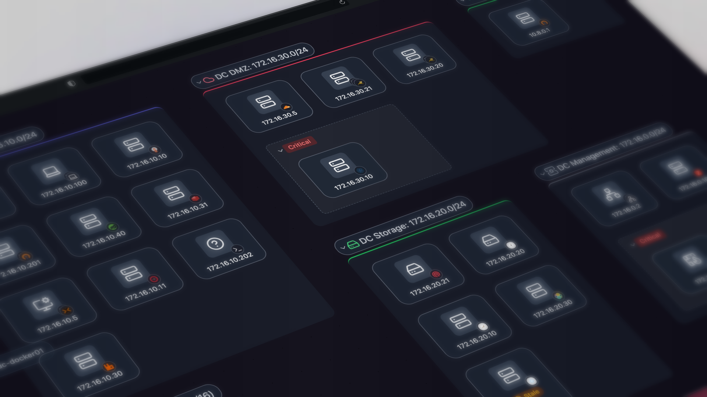
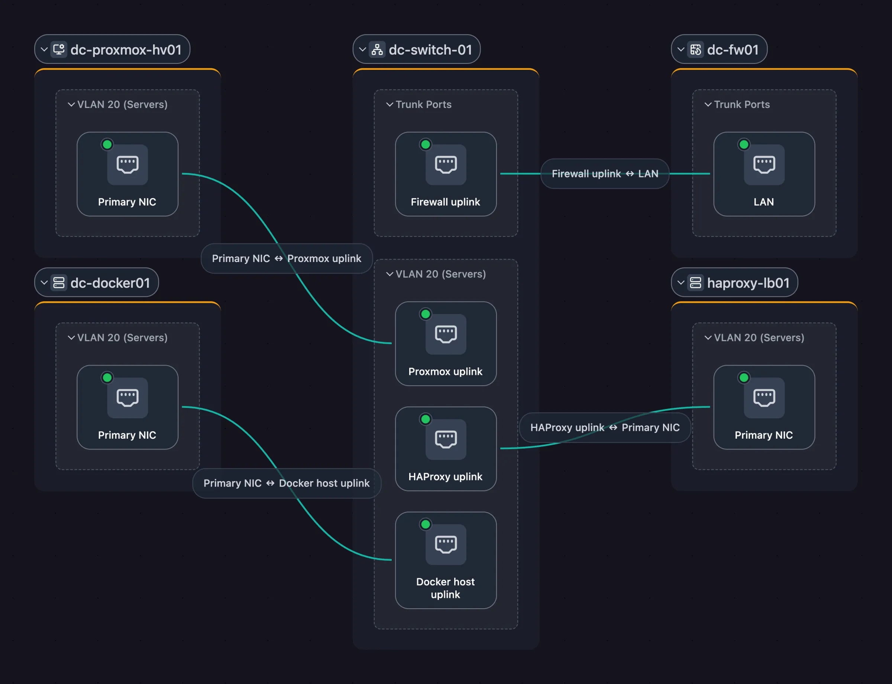
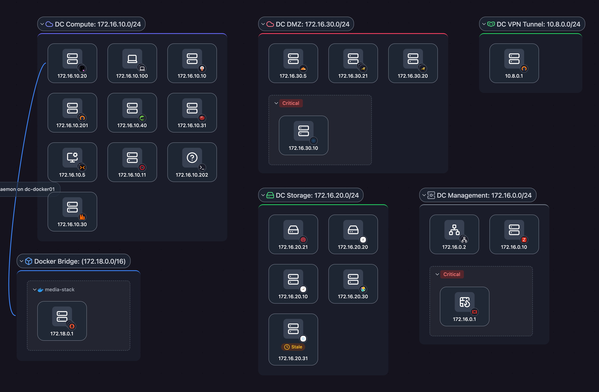
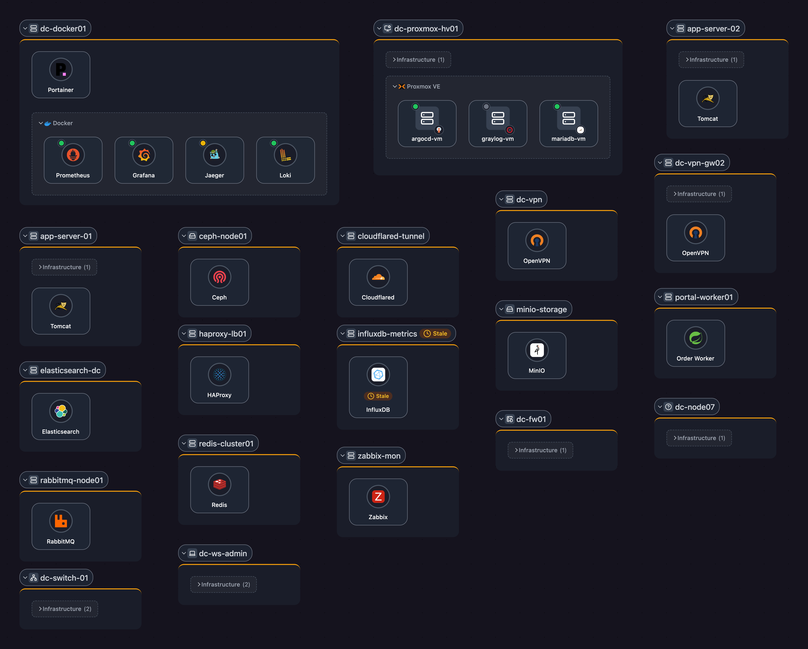
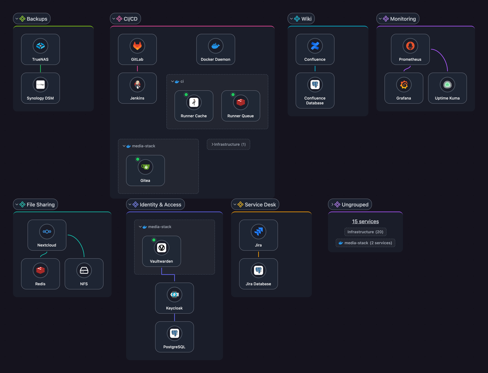

# Scanopy

<p align="left">
  
</p>

**Never maintain another network diagram.** Scanopy scans your network on a schedule and draws it as four views: L2, L3, workloads and applications.



```bash
curl -O https://raw.githubusercontent.com/scanopy/scanopy/refs/heads/main/docker-compose.yml
docker compose up -d
```

Open `http://<your-server-ip>:60072` and create your account. The first discovery starts on its own.

Prefer a hosted version? Try **[Scanopy Cloud](https://scanopy.net/pricing?utm_source=github&utm_medium=readme&utm_campaign=cloud_trial)**. Full setup options are in the **[docs](https://scanopy.net/docs?utm_source=github&utm_medium=readme&utm_campaign=docs)**.

  <br>
    <br>
[](https://discord.gg/b7ffQr8AcZ) [](https://hosted.weblate.org/engage/scanopy/)

Scanopy replaces manual network diagrams with a continuously maintained model of what's actually running. A single daemon scans on a schedule and produces four views from each scan: L2 (physical), L3 (logical), workloads, and applications. Unlike diagrams drawn in draw.io that go stale the week they're saved, or IaC state that misses drift and resources provisioned outside the pipeline, Scanopy reflects the current state of your infrastructure. Export as SVG, Mermaid, or Confluence; embed live maps; or feed the model into your existing source of truth.

> 🏢 **Running Scanopy for your business?** The [Commercial Edition](https://scanopy.net/commercial?utm_source=github&utm_medium=readme&utm_campaign=self_hosted_license) adds a commercial license, more networks and seats, Confluence export, and support, all on your own infrastructure.

<table>
  <tr>
    <td width="50%" valign="top">
      
      <p align="center"><strong>L2 (Physical)</strong><br/><sub>Every switch, every port, every link.</sub></p>
    </td>
    <td width="50%" valign="top">
      
      <p align="center"><strong>L3 (Logical)</strong><br/><sub>Subnets and how hosts connect across them.</sub></p>
    </td>
  </tr>
  <tr>
    <td width="50%" valign="top">
      
      <p align="center"><strong>Workloads</strong><br/><sub>Bare metal to hypervisors to containers.</sub></p>
    </td>
    <td width="50%" valign="top">
      
      <p align="center"><strong>Applications</strong><br/><sub>Services and their dependencies, grouped by application.</sub></p>
    </td>
  </tr>
</table>

## ✨ Features

**Map**
- **[Network topology](https://scanopy.net/product/network-topology?utm_source=github&utm_medium=readme&utm_campaign=features)**: Physical (L2) links port to port from LLDP, CDP, and switch forwarding tables, and logical (L3) topology subnet by subnet.
- **[Workload mapping](https://scanopy.net/product/workload-mapping?utm_source=github&utm_medium=readme&utm_campaign=features)**: VMs nested in their hypervisor, and containers inside the host that runs them.
- **[Application dependency mapping](https://scanopy.net/product/application-mapping?utm_source=github&utm_medium=readme&utm_campaign=features)**: Tag each server with its application once and the map fills in its services. You mark the dependencies between them.

**Inventory**
- **[Device inventory](https://scanopy.net/product/device-inventory?utm_source=github&utm_medium=readme&utm_campaign=features)**: Every host with its IP and MAC addresses, interfaces, open ports, services, and SNMP hardware facts. Search everything with `/`, filter by site or tag, and export to CSV or read it through the REST API.
- **[<!-- generated:service-count -->300+<!-- /generated --> service definitions](https://scanopy.net/services?utm_source=github&utm_medium=readme&utm_campaign=features)**: Identifies databases, web servers, printers, cameras, and industrial devices (Modbus TCP, EtherNet/IP, OPC UA, BACnet) by open ports, service responses, and MAC vendor.
- **[VLANs & subnets](https://scanopy.net/product/vlan-mapping?utm_source=github&utm_medium=readme&utm_campaign=features)**: Reads VLAN tables from your switches over SNMP, shows native and tagged VLANs per port, and links each VLAN to its subnets.

**Track & share**
- **[Scan digests and snapshots](https://scanopy.net/product/snapshots?utm_source=github&utm_medium=readme&utm_campaign=features)**: An email after each scheduled scan lists new, stale, and changed hosts. Snapshots record the network on a date for audits and change windows.
- **[Sharing, embeds & exports](https://scanopy.net/product/sharing-and-exports?utm_source=github&utm_medium=readme&utm_campaign=features)**: Read-only links with a password and expiry, live embeds in a wiki, and exports to image, document, diagram, and wiki formats.

**Discovery**
- **No agent per device**: A daemon on Linux, macOS, Windows, or Docker scans the networks it can reach. Deploy as many as your segments need, each on its own schedule, at the rate and subnet scope you set.
- **[Integrations](https://scanopy.net/integrations?utm_source=github&utm_medium=readme&utm_campaign=features)**: <!-- generated:integrations -->Docker, Aruba Instant On, Podman, Proxmox VE, UniFi Controller, Wake-on-LAN, SNMP, SSH, and gNMI<!-- /generated -->.
- **Multi-user + RBAC**: Admin, member, and viewer roles, scoped per site.

## 🎯 Built for teams that manage infrastructure

- **IT operations**: Network architecture and physical topology, current after every scan, across every site.
- **MSPs**: Per-client documentation with read-only portals. No logins required.
- **Security & compliance**: Segmentation validation and audit-ready documentation for NIS2, ISO 27001, HIPAA, and CMMC.
- **Platform & DevOps**: Service dependencies and workload placement without APM instrumentation.

Use cases: [compliance](https://scanopy.net/solutions/compliance?utm_source=github&utm_medium=readme&utm_campaign=use_cases), [multi-site networks](https://scanopy.net/solutions/multi-site-networks?utm_source=github&utm_medium=readme&utm_campaign=use_cases), [shadow IT discovery](https://scanopy.net/solutions/shadow-it?utm_source=github&utm_medium=readme&utm_campaign=use_cases), [plant & OT networks](https://scanopy.net/solutions/plant-ot-networks?utm_source=github&utm_medium=readme&utm_campaign=use_cases), [handover & onboarding](https://scanopy.net/solutions/network-handover?utm_source=github&utm_medium=readme&utm_campaign=use_cases).

## 📋 Editions and Licensing

Every edition runs on your own infrastructure, so discovery data, topology and credentials stay inside your network.

- **Community Edition ([AGPL-3.0](LICENSE.md)):** free and open source. AGPL-3.0 requires source disclosure for network services and copyleft compliance.
- **Commercial Edition (Self-Hosted Standard, Self-Hosted Plus, Enterprise):** a commercial license for organizations that can't meet AGPL-3.0's terms or need more networks and seats. Adds Confluence export, invoice billing, procurement documents and support. Self-Hosted Plus adds multiple organizations, and Plus and Enterprise add offline license keys for air-gapped networks.

**[Compare editions and get a commercial license](https://scanopy.net/commercial?utm_source=github&utm_medium=readme&utm_campaign=self_hosted_license)**, or email licensing@scanopy.net.

Prefer not to run it yourself? [Scanopy Cloud](https://scanopy.net/pricing?utm_source=github&utm_medium=readme&utm_campaign=cloud_trial) runs the same engine as a hosted service.

## 🚀 Quick Start for Self Hosting

**Docker Compose**

```bash
curl -O https://raw.githubusercontent.com/scanopy/scanopy/refs/heads/main/docker-compose.yml
docker compose up -d
```

**Proxmox**

Use this [helper script](https://community-scripts.github.io/ProxmoxVE/scripts?id=scanopy) to create a Scanopy LXC.

**Unraid**

Available as an Unraid community app.

---

Access the UI at `http://<your-server-ip>:60072`, create your account, and wait for the first discovery to complete.

Have a commercial license? See [Installing a Self-Hosted Server](https://scanopy.net/docs/self-hosted-server/installation/?edition=commercial&utm_source=github&utm_medium=readme&utm_campaign=docs).

For detailed setup options and configuration, see the [Installation Guide](https://scanopy.net/docs/self-hosted-server/installation/?utm_source=github&utm_medium=readme&utm_campaign=docs).

## 📚 Documentation + API

**[scanopy.net/docs](https://scanopy.net/docs?utm_source=github&utm_medium=readme&utm_campaign=docs)**

## 🚀 Demo

**[demo.scanopy.net](https://demo.scanopy.net/?utm_source=github&utm_medium=readme&utm_campaign=demo)**. Hosted demo app with a sample dataset. Try the full UI without installing anything.

## 🤝 Contributing

We welcome contributions! See our [contributing guide](contributing.md) for details.

Great first contributions:
- [Adding service definitions](contributing.md#adding-service-definitions)
- [Translating Scanopy](https://hosted.weblate.org/engage/scanopy/) into your language

## 💬 Community & Support

- **Discord**: [Join our Discord](https://discord.gg/b7ffQr8AcZ) for help and discussions
- **Issues**: [Report bugs or request features](https://github.com/scanopy/scanopy/issues/new)
- **Discussions**: [GitHub Discussions](https://github.com/scanopy/scanopy/discussions)

---
**Translations powered by Weblate**

**Built with ❤️ in NYC**
